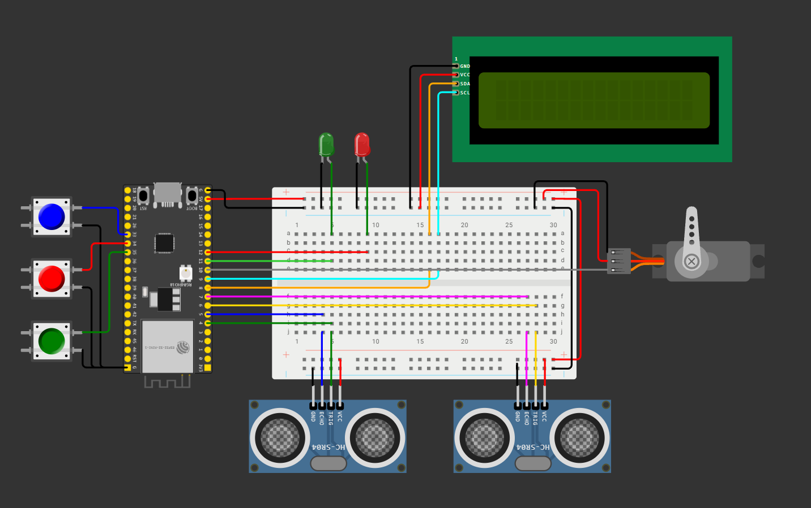

# SmartPark IoT

Estacionamento inteligente com mapa, escolha de vaga, reserva antecipada, pagamento online (Mercado Pago, modo teste), cancela controlada por ESP32 (simulado no Wokwi) e notificações no Telegram.

## Arquitetura

```
Navegador (Angular + Leaflet, porta 4200)
        |
        v
Backend Spring Boot (porta 8080) ----> Firebase Firestore
   ^            ^            |
   |            |            +-------> Telegram Bot API
   |            |
   |     túnel ngrok (HTTPS, domínio fixo)  <---- Webhook do Mercado Pago
   |
túnel Cloudflare (HTTPS, endereço temporário) <---- ESP32 no Wokwi
```

- O preço é sempre calculado no backend. A vaga escolhida no navegador é validada de novo no servidor, dentro de uma transação.
- O ESP32 se autentica com `X-Device-Id` e `X-Device-Secret`. O backend guarda apenas o hash SHA-256 do segredo.
- O webhook do Mercado Pago tem a assinatura `x-signature` validada, e o pagamento é consultado na API antes de confirmar a reserva.

## Tecnologias

| Parte | Tecnologia |
|---|---|
| Backend | Java 21, Spring Boot 4.1.2, Maven, Lombok, firebase-admin 9.11.0 |
| Front-end | Angular 22, Leaflet 1.9.4 |
| Banco | Firebase Firestore |
| Pagamento | Mercado Pago Checkout Pro (teste), chamado via API REST |
| Notificações | Telegram Bot API |
| IoT | ESP32-S2 no Wokwi (Arduino C++) |
| Execução | Docker Compose (backend, frontend, ngrok, cloudflared) |

## Estrutura de pastas

```
backend/     API Spring Boot (Dockerfile incluso)
frontend/    Dashboard Angular com mapa, escolha de vaga e detalhe da reserva
firmware/    sketch.ino, diagram.json e libraries.txt do Wokwi
docs/        Modelo do Firestore, relatório de testes e diagrama do circuito
docker-compose.yml
.env.example
```

## Como rodar (só precisa do Docker)

1. Instale e abra o **Docker Desktop**. Espere aparecer *Engine running*.
2. Na raiz do projeto, copie o arquivo de exemplo e preencha com as **suas** credenciais (veja a seção abaixo):
   ```powershell
   Copy-Item .env.example .env
   notepad .env
   ```
   No Mac: `cp .env.example .env` e `open -e .env`. Sem espaços e sem aspas. Em `FIREBASE_KEY_PATH` use barras normais, por exemplo `C:/chaves/firebase.json` (Windows) ou `/Users/nome/chaves/firebase.json` (Mac). A chave do Firebase fica **fora** da pasta do projeto.
3. Garanta que as portas **8080** e **4200** estão livres.
4. Suba tudo:
   ```bash
   docker compose up --build -d
   ```
   A primeira vez demora alguns minutos. Confira com `docker compose ps` (quatro serviços `Up`).
5. Acesse:
   - Mapa: `http://localhost:4200`
   - API pública: `https://SEU-DOMINIO-NGROK/api/parking-lots`
6. Pegue o endereço atual do túnel do ESP32 (ele muda a cada vez que o serviço sobe; vale só o último):
   - Windows: `docker compose logs tunnel-esp32 | Select-String -Pattern 'https://[a-z0-9-]+\.trycloudflare\.com' | Select-Object -Last 1`
   - Mac/Linux: `docker compose logs tunnel-esp32 | grep -o 'https://[a-z0-9-]*\.trycloudflare\.com' | tail -1`
7. No Wokwi, numa cópia do projeto, coloque `FORCAR_SIMULADO = false`, o endereço acima em `BASE_URL`, o seu `DEVICE_SHARED_SECRET` em `DEVICE_SECRET` e escolha o portão em `DEVICE_ID`: `esp32-portao-01` (Unidade Shopping) ou `esp32-portao-centro` (Unidade Centro). Inicie a simulação.

Para parar: `docker compose down`. O domínio do ngrok só funciona em um computador por vez.

Depois de atualizar o código (`git pull`): `docker compose up --build -d` e `docker compose restart frontend`.

## Usando as suas próprias credenciais

Cada pessoa usa as próprias contas. Nada disso vem no repositório.

1. **Firebase:** crie um projeto e ative o **Firestore**. Em *Configurações do projeto → Contas de serviço*, gere uma nova chave privada (`.json`) e guarde fora da pasta do projeto. Preencha `FIREBASE_KEY_PATH` e `FIREBASE_PROJECT_ID`. Com `SEED_ENABLED=true`, os estacionamentos e portões de demonstração são criados na primeira execução.
2. **ngrok:** crie uma conta, copie o *Authtoken* e reserve o domínio estático gratuito em *Domains*. Preencha `NGROK_AUTHTOKEN` e `NGROK_DOMAIN`.
3. **Mercado Pago:** em *Suas integrações*, crie uma aplicação e copie o *Access Token de teste*. Em *Webhooks*, configure a URL `https://SEU-DOMINIO-NGROK/webhooks/mercadopago` com o evento *Pagamentos* e copie a assinatura secreta. Crie contas de teste (vendedor e comprador) e pague com a conta compradora numa janela anônima.
4. **Telegram:** crie um bot com o @BotFather e copie o token. Mande uma mensagem para o bot e abra `https://api.telegram.org/botSEU_TOKEN/getUpdates` para descobrir o `chat.id`.
5. **Segredo do dispositivo:** gere um valor aleatório longo para `DEVICE_SHARED_SECRET` e use o mesmo valor no `DEVICE_SECRET` do Wokwi.

## Variáveis de ambiente (`.env`)

| Variável | Uso |
|---|---|
| `NGROK_AUTHTOKEN` | Token da conta ngrok |
| `NGROK_DOMAIN` | Domínio fixo do ngrok, **sem** `https://` |
| `DEVICE_SHARED_SECRET` | Segredo dos portões (o backend grava só o hash) |
| `MERCADOPAGO_ACCESS_TOKEN` | Access token **de teste** do Mercado Pago |
| `MERCADOPAGO_WEBHOOK_SECRET` | Assinatura secreta do webhook |
| `TELEGRAM_BOT_TOKEN` | Token do bot criado no BotFather |
| `TELEGRAM_DEFAULT_CHAT_ID` | Chat que recebe as mensagens |
| `FIREBASE_KEY_PATH` | Caminho da chave do Firebase no computador (montada no container) |
| `FIREBASE_PROJECT_ID` | Id do projeto Firebase |
| `SEED_ENABLED` | `true` cria os dados de demonstração se ainda não existirem |

O `APP_BASE_URL` é montado pelo compose a partir do `NGROK_DOMAIN`. O `GOOGLE_APPLICATION_CREDENTIALS` aponta para a chave montada dentro do container.

## Endpoints

| Método e rota | Uso | Proteção |
|---|---|---|
| `GET /api/parking-lots` | Lista locais, vagas totais e livres agora | Pública, só campos públicos |
| `GET /api/parking-lots/{id}/availability?from=&to=` | Quantidade de vagas livres no período | Datas validadas no servidor (máx. 24 h) |
| `GET /api/parking-lots/{id}/spaces?from=&to=` | Vagas do local com estado (livre/ocupada) no período | Datas validadas no servidor |
| `POST /api/reservations` | Cria reserva `PENDING_PAYMENT` | Valida datas, horário de funcionamento e conflito em transação; vaga escolhida pelo cliente (opcional) revalidada; preço calculado no servidor |
| `GET /api/reservations/{id}` | Consulta reserva | Só reservas do usuário (ver limitações) |
| `POST /api/reservations/{id}/checkout` | Cria checkout no Mercado Pago | Valor vem do banco |
| `POST /webhooks/mercadopago` | Notificação de pagamento | HTTPS, assinatura validada, consulta à API, idempotente |
| `POST /api/iot/access-request` | Entrada/saída pela cancela | Autenticação do dispositivo, idempotente por `event_id` |
| `POST /api/iot/telemetry` | Sinal de vida do dispositivo | Autenticação do dispositivo |

## Regras de negócio

- Tarifa por hora com preço fixo antecipado, mínimo de 1 hora, arredondando para cima. Valores em centavos.
- Reserva só dentro do horário de funcionamento (06:00 às 22:00, fuso `America/Bahia`), no mesmo dia, com no máximo 24 h.
- Pagamento em até 15 minutos. Depois disso a reserva expira (job a cada minuto).
- Entrada liberada de 15 minutos antes da chegada até a saída prevista, só para reserva `CONFIRMED` no estacionamento do portão.
- A saída é sempre liberada para quem está dentro. Ela gera o ticket (`tickets/{reservationId}`) e o comprovante no Telegram. Tolerância de 10 minutos; o excedente é registrado e gera alerta, sem segunda cobrança.
- Eventos repetidos (mesmo `event_id`) devolvem o mesmo resultado sem novo efeito.
- Mensagens do Telegram que falham ficam `PENDING_RETRY` e são reenviadas a cada minuto (até 5 tentativas).
- Portão sem sinal por mais de 2 minutos gera alerta no Telegram.

Status da reserva: `PENDING_PAYMENT`, `CONFIRMED`, `CHECKED_IN`, `COMPLETED`, `EXPIRED`.

## Firmware (Wokwi)

Projeto: https://wokwi.com/projects/479136319418605569

O link abre em **modo simulado** (`FORCAR_SIMULADO = true`), sem depender do backend: digite `a`, `n` ou `f` no Monitor Serial e use os botões ou os sensores. Para ligar ao seu backend, faça uma cópia do projeto (*Save a copy*) e siga o passo 7 de "Como rodar".



| Componente | Pino |
|---|---|
| HC-SR04 entrada (TRIG/ECHO) | 4 / 5 |
| HC-SR04 saída (TRIG/ECHO) | 6 / 7 |
| LCD I2C 16x2 (SDA/SCL), endereço 0x27 | 8 / 9 |
| Servo da cancela | 10 |
| LED verde / LED vermelho | 11 / 12 |
| Botões entrada / saída / manutenção (ao GND) | 33 / 34 / 35 |

- Sensores: um carro a menos de 30 cm por 0,6 s dispara o pedido de entrada ou saída.
- Botões de entrada e saída: fazem o mesmo manualmente.
- Botão de manutenção: trava a cancela (LED vermelho piscando) até ser apertado de novo.
- Estados: `PRONTO`, `CONSULTANDO`, `ABERTA`, `NEGADO`, `FALHA_REDE` (cancela fechada) e `MANUTENCAO`.

Portões cadastrados pelo seed (cada um só abre para reservas do seu local; reserva de outro local aparece como "OUTRO LOCAL"):

| `DEVICE_ID` | Estacionamento |
|---|---|
| `esp32-portao-01` | Unidade Shopping |
| `esp32-portao-centro` | Unidade Centro |

Comandos no Monitor Serial:
- `r:CODIGO_DA_RESERVA` define a reserva lida no portão (representa um leitor de QR Code).
- `a`, `n` e `f` simulam autorizado, negado e falha de rede (só no modo simulado).

## Pagamento de teste

Pague numa **janela anônima** usando a **conta de teste comprador** do Mercado Pago. Cartão de teste Visa `4235 6477 2802 5682`, CVV `123`, validade `11/30`, CPF `12345678909`. Titular `APRO` aprova e `OTHE` recusa.

## Segurança

- `.env`, `.idea` e chaves do Firebase estão no `.gitignore` e nunca são versionados.
- Segredos só em variáveis de ambiente. Se algum vazar, ele deve ser revogado e gerado de novo.
- Logs e mensagens do Telegram não incluem tokens nem dados de cartão.

## Limitações conhecidas

- **Sem login de usuário**: o Firebase Auth não foi implementado. Todas as rotas usam o usuário fixo `demo-user`, então não há como impedir que alguém consulte a reserva de outra pessoa (o T14 não é testável).
- Cancelamento com reembolso (regra de 3 horas), "Minhas reservas" e painel administrativo (RF10) não foram implementados.
- O Telegram envia tudo para um chat fixo (`TELEGRAM_DEFAULT_CHAT_ID`).
- Os dois portões usam o mesmo `DEVICE_SHARED_SECRET`; o ideal seria um segredo por dispositivo.
- A rede do Wokwi não conseguiu abrir HTTPS com o domínio do ngrok (o handshake TLS é encerrado). Por isso o ESP32 usa um túnel temporário da Cloudflare, cujo endereço muda a cada execução.

## Documentação

- `docs/modelo-firestore.md`: coleções, campos e exemplos.
- `docs/relatorio-testes.md`: testes T01 a T15, com entradas, resultados e correções.